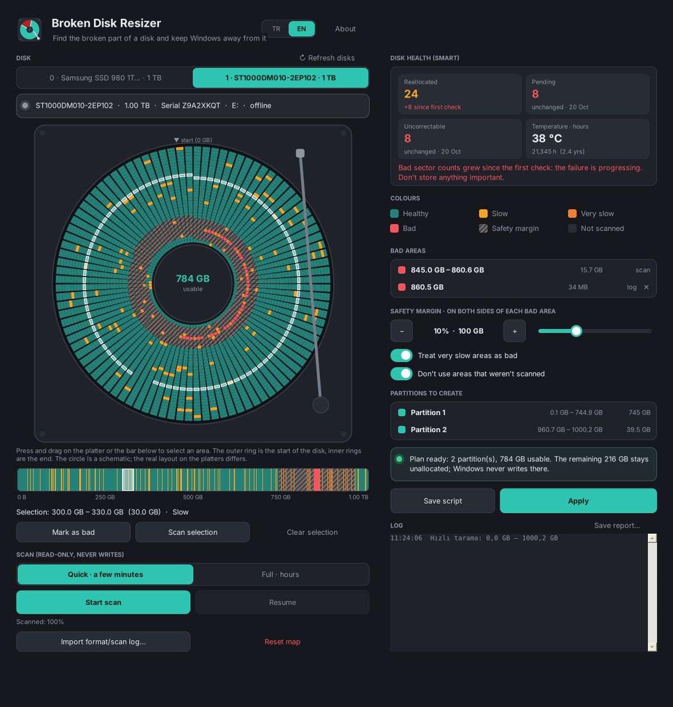

<h1 align="center">Broken Disk Resizer</h1>

<b>Diskin bozuk kısmını bul, Windows'un dışında bırak.</b> 
Bozuk sektörleri olan bir hard diskin hatalı bölgesini bulur, çevresine güvenlik payı bırakır ve diski sadece sağlam kalan kısımlarda bölümler.

<a href="#english">English</a> · <a href="https://github.com/HErkanuzun/BrokenDiskResizer/releases/latest">İndir / Download</a> · <a href="CHANGELOG.md">Sürüm geçmişi</a>

> ⚠️ **Bu araç diski onarmaz.** Bozuk sektörleri artan bir disk genelde ilerleyen bir arızadır; bugün tek bir yerdeki sorun yarın başka yerde çıkabilir. Bu diske önemli hiçbir şey koyma, yedeğin başka yerde olsun. Programdaki **Diskin sağlığı** kartı sayıların artıp artmadığını gösterir.

[Broken Screen Resizer](https://github.com/HErkanuzun/BrokenScreenResizer) ile aynı fikir, bu sefer monitör yerine disk için.

## Broken ailesi

Windows'ta bozuk ya da sorunlu bir şeyi bulup onunla yaşamanı sağlayan küçük araçlar. Hepsi aynı tasarım dilinde, ücretsiz ve açık kaynak.

| | |
|---|---|
| [Broken Screen Resizer](https://github.com/HErkanuzun/BrokenScreenResizer) | Monitörün bozuk kısmını Windows'un dışında bırakır. |
| **Broken Disk Resizer** | Hard diskin bozuk sektörlerini bulur, sadece sağlam kısımları bölümler. |
| [Broken Space Finder](https://github.com/HErkanuzun/BrokenSpaceFinder) | Diski neyin doldurduğunu bulur ve güvenle temizler. |
| [Broken Microphone](https://github.com/HErkanuzun/BrokenMicrophone) | Telefonu ya da tableti bilgisayarın mikrofonu yapar. |
| [Broken Hub](https://github.com/HErkanuzun/BrokenHub) | Bütün Broken araçlarını tek yerden kurar, günceller ve açar. |

## Kurulum

1. [Son sürümden](https://github.com/HErkanuzun/BrokenDiskResizer/releases/latest) `BrokenDiskResizer-1.0-Setup.exe`'yi indir ve çalıştır.
2. Başlat menüsünden **Broken Disk Resizer**'ı aç. Diskleri okuyabilmek için yönetici izni ister.

Kurulum istemiyorsan `Portable.zip`'i aç, içindeki exe'yi çalıştır.

Kaldırmak için: Windows **Ayarlar → Uygulamalar → Broken Disk Resizer → Kaldır**. Tarama haritalarının da silinip silinmeyeceğini sorar.

> Exe imzalı olmadığı için Windows SmartScreen ilk açılışta "Windows bilgisayarınızı korudu" diyebilir: **Ek bilgi → Yine de çalıştır**.

## Nasıl kullanılır

1. **Diski seç.** Üstte model ve seri numarasıyla listelenir. Doğru disk olduğundan emin ol.
2. **Sağlığına bak.** Sağdaki SMART kartı yeniden atanmış, bekleyen ve düzeltilemeyen sektör sayılarını ve ilk kontrolden beri artışı gösterir.
3. **Tara.** *Hızlı tarama* diskin her ~60 MB'lık parçasından bir örnek okur (1 TB birkaç dakika). Şüpheli bir yer çıkarsa o alanı seçip **Seçimi tam tara**. Tarama diske hiçbir şey yazmaz.
   Elinde bir format log'u varsa (ör. *HDD Low Level Format Tool*) **Format/tarama log'u içe aktar…** ile hatalı yerleri direkt haritaya ekleyebilirsin.
4. **Haritaya bak.** Disk bir plaka gibi çizilir: dış halka diskin başı, içe doğru sonu. Kırmızı bozuk, çizgili güvenlik payı. Plakada ya da alttaki şeritte sürükleyerek alan seçip **elle bozuk işaretleyebilirsin**.
5. **Güvenlik payını ayarla.** Varsayılan: her bozuk bölgenin iki yanına disk boyutunun **%10'u**. Bozukluk genelde çevresine yayılır.
6. **Uygula** → `SİL` yaz → onayla. Disk silinir, sağlam aralıklara NTFS bölümleri açılır (`SAGLAM1`, `SAGLAM2`…). Bozuk bölge ve payı **ayrılmamış** kalır; Windows oraya hiç yazmaz.
   İstersen önce **Betiği kaydet** ile çalıştırılacak `diskpart` komutlarını oku.

## Özellikler

| | |
|---|---|
| **Salt okunur tarama** | Disk yalnızca okuma izniyle açılır. Takılan okuma 8 sn sonra iptal edilir, o yer bozuk sayılır. Art arda okunamayan yerlerde ileri atlanır. |
| **Disk düşerse** | Okuma sırasında disk Windows'tan tamamen düşerse (hata 433) tarama güvenle durur, harita kaydedilir, o yer "disk düştü" olarak işaretlenir. Kablolar çıkarılıp takılınca liste kendiliğinden yenilenir; tam tarama **Devam et** ile ileriden sürer. |
| **Bilinen bozuk yerler okunmaz** | Log'dan gelen, elle işaretlenen ve diskin düştüğü yerler (1 GB payla) hiçbir taramada tekrar okunmaz, böylece disk ikinci kez düşürülmez. |
| **SMART geçmişi** | Her diskin sayaçları saklanır; kart "ilk kontrolden beri +8" gibi artışı gösterir. |
| **Uzun taramalar** | Görev çubuğu simgesinde ilerleme çubuğu, bitince simge yanıp söner; tarama sürerken bilgisayar uykuya geçmez. |
| **Korumalar** | Windows'un/önyüklemenin/programın kendisinin bulunduğu disk bölümlenemez. Uygulamadan hemen önce disk seri numarasıyla yeniden doğrulanır. Bölümleme sürerken program kapatılamaz. |
| **Rapor** | **Raporu kaydet…** disk, SMART, bozuk bölgeler, plan ve kaydı tek bir metin dosyasına yazar. |

### Renkler

| Renk | Anlamı |
|---|---|
| Turkuaz | Sağlam okundu |
| Sarı | Yavaş (80–300 ms / MB) |
| Turuncu | Çok yavaş (300–2000 ms / MB), varsayılan olarak bozuk sayılır |
| Kırmızı | Okunamadı, zaman aşımı, disk düştü ya da log'da/elle işaretli |
| Kırmızı çizgili | Güvenlik payı, kullanılmayacak |
| Gri | Taranmadı (varsayılan olarak kullanılmaz) |

## Kaynaktan derleme

Ek bir araç gerekmez; Windows'un kendi .NET Framework 4 derleyicisi kullanılır.

| Dosya | Ne yapar |
|---|---|
| `build.bat` | Sadece programı derler → `bin\BrokenDiskResizer.exe` |
| `paketle.bat` | Programı derler, Inno Setup yoksa `winget` ile kurar, `dist\` klasörüne **Setup.exe**, **Portable.zip** ve **SHA256SUMS.txt** üretir |

GitHub'a `v1.0` gibi bir etiket gönderildiğinde aynı paketler Actions ile derlenip sürüm olarak yayımlanır.

Harita, SMART geçmişi ve ayarlar `%AppData%\BrokenDiskResizer` klasöründe tutulur.

## Sınırlar

- Dairesel görünüm bir şemadır. Gerçek bir diskte sektörler birden fazla plakaya ve yüzeye dağılır.
- SMART sayaçları Windows'un standart SATA sürücüsünden okunur. NVMe diskler, USB kutuları ve bazı RAID sürücüleri bunları vermez; o durumda CrystalDiskInfo kullan.
- Windows 10 ve üstü gerekir.

---

## English

**Broken Disk Resizer** finds the broken area of a hard disk with bad sectors, leaves a safety margin around it and partitions only the healthy parts. The bad area stays unallocated, so Windows never writes there.

> ⚠️ It does **not** repair the disk. A disk with growing bad sectors is usually dying; keep anything important elsewhere. The **Disk health** card shows whether the counts are growing.

**Install:** download `BrokenDiskResizer-1.0-Setup.exe` from the [latest release](https://github.com/HErkanuzun/BrokenDiskResizer/releases/latest) (or use the portable ZIP). The app asks for administrator rights because it reads disks sector by sector.

**Use:** pick the disk → check its SMART health → run a quick scan (read-only, a few minutes per TB) or import a format-tool log → look at the platter map, select and mark areas by hand if needed → set the safety margin (default 10% of the disk on each side of every bad area) → **Apply**, type `ERASE`. The disk is erased and NTFS partitions are created on the healthy ranges only.

**Safety:** scans never write; known bad areas (imported, marked, or where the disk dropped out) are never read again; the Windows/boot disk is refused; the disk is re-identified by serial number right before partitioning; the app can't be closed while partitioning. See [SECURITY.md](SECURITY.md) for everything the app does on your computer.

**Build:** `build.bat` builds the exe with the .NET Framework compiler that ships with Windows. `paketle.bat` also builds the installer, portable ZIP and checksums (it installs Inno Setup with winget if needed).

**The Broken family:** [Broken Screen Resizer](https://github.com/HErkanuzun/BrokenScreenResizer) (keeps a monitor's broken area out of use) · **Broken Disk Resizer** · [Broken Space Finder](https://github.com/HErkanuzun/BrokenSpaceFinder) (finds what's filling up your disk and cleans it safely) · [Broken Microphone](https://github.com/HErkanuzun/BrokenMicrophone) (turns a phone or tablet into the computer's microphone) · [Broken Hub](https://github.com/HErkanuzun/BrokenHub) (installs, updates and opens all the Broken tools from one place).

**[Code signing policy](SECURITY.md#code-signing-policy)** · Free code signing by SignPath Foundation · Kod imzalama politikası

MIT License.
